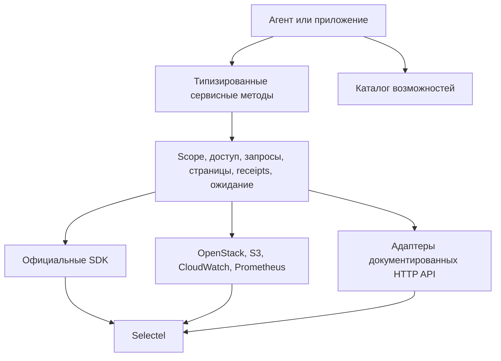

# selectelsdk

## Назначение

`selectelsdk` — общая Go-библиотека программного управления Selectel для агента
или приложения. Библиотека предоставляет типизированные методы по сервисам и
машинно читаемый каталог возможностей. Перенос существующей инфраструктуры является одним из её применений.

Спецификация задаёт desired state библиотеки согласно
[ADR-0005](../../adr/0005-selectelsdk-common-cloud-library.md).
Публичный контракт состоит из сервисных методов и общих правил этой папки.

## Границы ответственности

Библиотека обеспечивает:

- явную авторизацию и обновление доступа;
- неизменяемый выбор аккаунта, проекта, региона, пула и поколения API;
- разрешение endpoint через каталог провайдера и документированные адреса;
- ограниченный обход страниц результатов;
- чтение состояния, ожидание операций, deadlines и локальную отмену;
- единые ошибки, подтверждение принятия изменений и неизвестный исход;
- операции официальных SDK и недостающие операции документированных API;
- передачу бинарных данных потоками и явный доступ к чувствительным значениям;
- описание покрытия, ограничений и проверенности каждой операции.

Целевая граница покрытия — все публично документированные API Selectel и
документированные совместимые протоколы. В неё входят управление доступом,
вычислениями, сетями, Kubernetes, базами данных, хранилищами, резервным
копированием, реестрами, DNS, сертификатами, секретами, биллингом и телеметрией,
а также остальные семейства из [реестра сервисов](services.md).

Библиотека не использует недокументированные API панели, автоматизацию браузера
или reverse engineering для расширения покрытия. Возможность, присутствующая
только в панели, получает `discovery_pending` до появления публичного контракта.

Вызывающая сторона выбирает действия и отвечает за разрешение их выполнения.
SDK выполняет явно вызванные операции в пределах фактических прав credentials.
Он не согласовывает действия с человеком, не расширяет RBAC автоматически и
не выбирает другую область доступа после `403`.

SDK не владеет Terraform state, циклом reconciliation, миграцией прикладных
данных или проверкой здоровья приложений. Операции восстановления ресурсов,
если они документированы провайдером, входят в соответствующий сервисный API.
`Wait` подтверждает состояние провайдера, заданное целью ожидания.

SDK не требует CLI, MCP, сервера, фонового daemon, PostgreSQL или Redis.
Его изменяемое локальное состояние ограничено [кэшами](caches.md).
Сохранение результатов и receipts принадлежит вызывающей стороне.

## Зависимости

Библиотека располагается в корневом Go-модуле `github.com/festy23/selectel-sdk`, использует
Go 1.26 или новее и не зависит от application services этого репозитория.
Go-модуль публикуется из репозитория `festy23/selectel-sdk`.

Официальные Go SDK, OpenStack, AWS и HTTP-адаптеры подключаются по
[правилам зависимостей](dependencies.md). Все сервисы используют одно ядро
авторизации, бюджетов запросов, ошибок и наблюдения операций. Terraform provider
служит источником подтверждённых интеграционных решений; его state и CRUD
обработчики не являются runtime-зависимостью SDK.

## Контракты

| Документ | Содержание |
|---|---|
| [dedicated.md](dedicated.md) | Dedicated V2 lifecycle и provider field waits |
| [interface.md](interface.md) | Пакеты, общие типы, сервисные методы и совместимость |
| [access.md](access.md) | Credentials, scope, авторизация, endpoints |
| [execution.md](execution.md) | Запросы, повторные попытки, receipts, ошибки, чувствительные значения |
| [pagination.md](pagination.md) | Страницы, итераторы, ограничения и полнота |
| [operations.md](operations.md) | Состояние, ожидание, восстановление исхода и отмена |
| [services.md](services.md) | Семейства API и контракт расширения покрытия |
| [scenarios.md](scenarios.md) | Начальные сквозные операции |
| [catalog.md](catalog.md) | Машинный каталог и правила учёта покрытия |
| [dependencies.md](dependencies.md) | SDK, совместимые протоколы и reuse Terraform provider |
| [settings.md](settings.md) | Типы, значения и ограничения настроек |
| [caches.md](caches.md) | Локальные кэши и конкурентное обновление |

## Порядок расширения

Начальное покрытие включает авторизацию, каталог, ограниченный инвентарь,
жизненный цикл одной VM на существующих зависимостях, баланс и статистику,
чтение логов, метрик и аудит-событий, чтение метаданных секретов и явное чтение
значения секрета. Контракты задаёт [scenarios.md](scenarios.md).

Следующие операции добавляются по [контракту расширения](services.md#расширение-покрытия).
Полнота начальных сценариев и полное покрытие API учитываются раздельно по
[catalog.md](catalog.md). Импорт SDK, наличие метода или успешный общий HTTP-запрос
не подтверждают полное покрытие сервиса.
